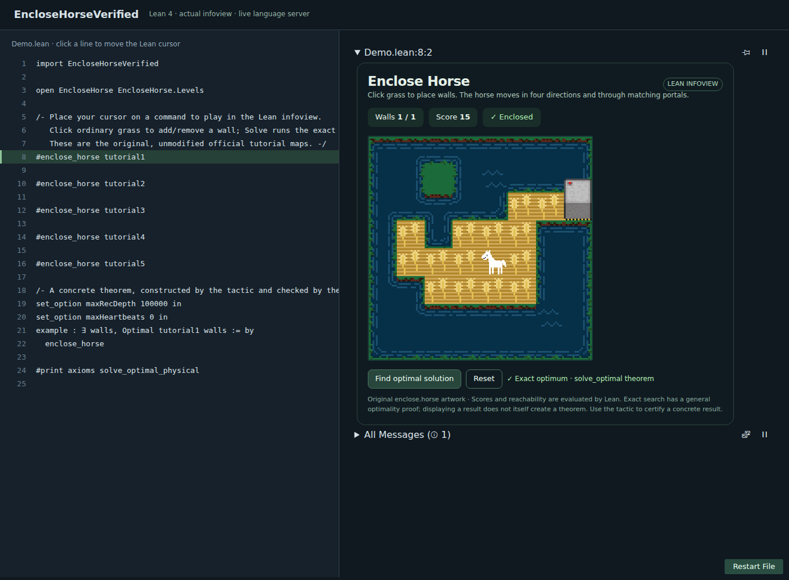
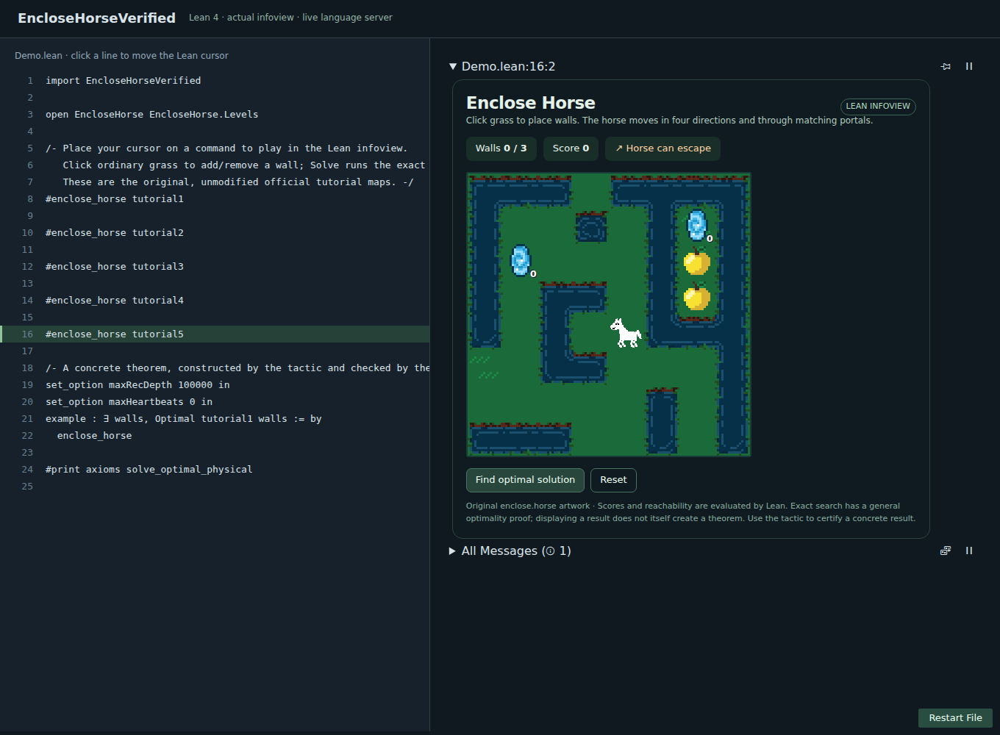

# EncloseHorseVerified

A playable implementation of [enclose.horse](https://enclose.horse/) inside the **Lean 4.35.0 infoview**, with an exhaustive exact solver, a solution-finding tactic, and a kernel-checked proof of global optimality.

## Play in the infoview

1. Install Lean through [elan](https://github.com/leanprover/elan) and the official **lean4** VS Code extension.
2. Clone this repository, run `lake build`, and open `Demo.lean` in VS Code.
3. Put the cursor on a `#enclose_horse tutorial1` command. Enable **Lean: Infoview** if needed.
4. Click grass tiles to place or remove walls. The score, enclosure status, and horse's reachable region update through the Lean server. **Reset** clears walls; **Find optimal solution** runs the proved solver.

All five official tutorial levels are included. Special tiles cannot be walled over. Portal labels are displayed on the board. No npm installation is needed for the VS Code widget.





The screenshots are captured from the actual `@leanprover/infoview` running against a live Lean language server. The reproducible browser host and interaction test are in [`tools/`](tools/README.md).

## Find and prove a solution

```lean
import EncloseHorseVerified
open EncloseHorse EncloseHorse.Levels

#solve_enclosure tutorial1  -- some [23]

set_option maxRecDepth 100000 in
set_option maxHeartbeats 0 in
example : ∃ walls, Optimal tutorial1 walls := by
  enclose_horse

example : Optimal tutorial1 [23] := by
  enclose_horse
```

The tactic executes exact search to discover the walls, then constructs `solve_optimal` with a solver equation checked using **`decide +kernel`**. Witness discovery is untrusted; the final theorem is checked by Lean. Fixed-placement goals must specify the solver's selected optimum; use the existential form to let the tactic find it. Ties are deterministic.

## What is proved

The specification is independent of the enumeration:

```lean
Optimal b walls :=
  admissible b walls ∧
  ∀ other, admissible b other → score b other ≤ score b walls

solve_optimal b walls :
  solve b = some walls → Optimal b walls

solve_optimal_physical b walls :
  solve b = some walls → PhysicalOptimal b walls
```

`PhysicalOptimal` quantifies over **all distinct legal grass-cell lists within budget, in any order**. Canonicalization preserves their membership, reachability, and score. The search-space completeness proof shows every such placement is represented. `solve_eq_none_iff` proves that failure means no enclosure exists.

The executable flood fill is proved equivalent to inductive paths of arbitrary length (`mem_reach_iff`), is duplicate-free (`reach_nodup`), and characterizes boundary escape (`enclosed_iff`). Structural recursion makes concrete solver equations reducible by the kernel.

There are no `sorry`s, custom axioms, or native-reflection certificates. The audit in `Tests/Trust.lean` checks the principal theorems against Lean's standard axioms (`propext`, `Classical.choice`, `Quot.sound`). The frontend draws the game; all gameplay evaluation and search run in Lean RPC methods. A displayed solver result is backed by the general theorem; invoking the tactic creates a concrete theorem in the source file.

## Rules and scope

Standard mode: four-way movement, water barriers, open board edges, an upper bound on walls, and linked matching portals. Every reachable tile contributes one point; cherries add 3, apples add 10, and bees subtract 5. Signed integer scores preserve negative totals. Walls can be placed only on ordinary grass; the horse and special items count as area.

A solution **must enclose the horse**. The solver therefore optimizes among enclosures even if all their scores are negative; it returns `none` if no enclosure exists. An escaped placement has game score zero but is not a solution. Optional bonus modes (unicorns, costly walls, lava gates) and preset `W` maps are outside this implementation. The checked parser rejects unsupported symbols.

This is a finite exhaustive algorithm: it always terminates, but its search is exponential. Kernel certification costs more than running compiled search. The small official tutorials are practical examples; large daily puzzles may be expensive.

## Validation

```sh
lake build encloseHorse
lake env lean Tests/Rules.lean
lake env lean Tests/Fixtures.lean
lake env lean Tests/Tactic.lean
lake env lean Tests/Trust.lean
lake env lean Demo.lean
lake exe encloseHorse --json > /tmp/enclose-results.json
python3 scripts/verify_fixtures.py --lean-json /tmp/enclose-results.json
```

The compiled Lean solver is tested on three unmodified real official levels, including portals and apples. All five official witness placements have kernel-checked legality, enclosure, and exact-score proofs. The first tutorial also has an explicit kernel-checked global-optimality theorem. An independent Python exhaustive solver checks all five optima and independently recomputes Lean outputs with set-based BFS.

| Official tutorial | Wall budget | Optimum | Placements |
|---|---:|---:|---:|
| 1 | 1 | 15 | 17 |
| 2 | 3 | 17 | 3,683 |
| 3 | 5 | 12 | 384,168 |
| 4 | 6 | 31 | 1,391,842 |
| 5, portals | 3 | 39 | 2,626 |

`lake exe encloseHorse --all` runs exact Lean search on all five, including the larger benchmarks. `--all --witnesses` checks all stored witnesses quickly. Source URLs and retrieval hashes are recorded in [`data/README.md`](data/README.md).

## Layout

| File | Purpose |
|---|---|
| `Reachability.lean` | Terminating flood fill and unbounded-path correctness |
| `Game.lean` | Terrain, parser, legality, score, physical-placement correspondence |
| `FiniteSearch.lean` | Complete bounded-subset enumeration and maximum-selection proof |
| `Solver.lean` | Exact solver, global optimality, impossibility theorem |
| `Tactic.lean` | `enclose_horse` and `#solve_enclosure` |
| `Widget.lean`, `widget/encloseHorse.js` | Playable native infoview and Lean RPCs |
| `Levels.lean`, `Tests/` | Official levels and regression/certificate tests |

The Lean implementation has no external Lean package dependencies. The original game is by the enclose.horse team; this independent educational implementation uses its published rules and five small tutorial fixtures. Original game code and artwork are not included. See [`NOTICE`](NOTICE).
